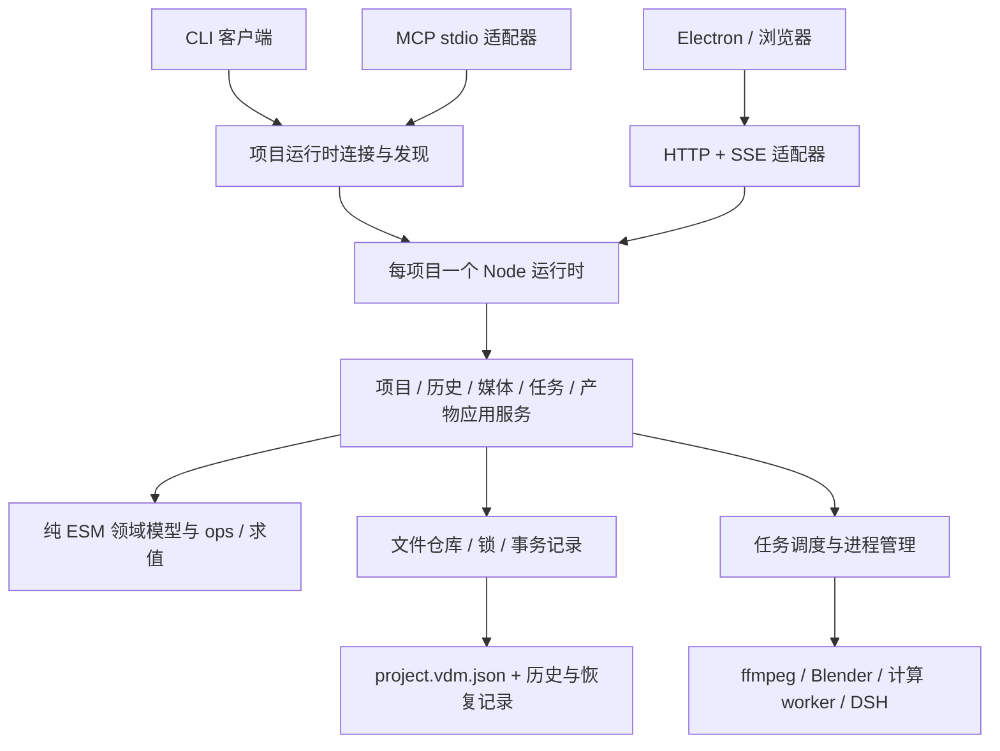

# 底层架构评审与 MCP 接入方案

评审日期：2026-10-26。基线提交：`764f253`，包含当前工作区的示例项目修改。

评审时仅验证和制定方案，没有修改运行代码或示例项目。后续实现进度见第 8 节；下文的目标结构与 MCP 接口描述仍作为分阶段设计使用。

## 1. 结论与改造边界

项目适合增加 MCP：JSON 项目、结构化 ops、纯函数求值、Node 引擎与 Blender job 已经构成了可复用的基础。主要问题是**公共应用层尚未形成**：事务、历史、任务和产物的生命周期散落在 HTTP 闭包、CLI 与子进程封装中。

建议将目标定义为：**一个项目运行时、一套应用服务，CLI / HTTP / MCP 使用相同的业务契约。** 先修复已存在的数据与渲染问题，再抽取服务，最后接入 MCP。仅给现有 CLI 套进程调用，或者把 REST 路由逐个翻译成 MCP tool，都不能解决目前的状态一致性问题。

保留这些已有选择：

- `project.vdm.json` 继续作为编辑状态的唯一真相源；暂时没有证据表明需要数据库。
- 保留结构化 ops、整批失败不落盘、文件锁与原子替换。
- 保留浏览器和 Node 共用的 ESM 数学模型，以及 Blender 无头渲染。
- 保留零 npm 依赖、原生 UI 和 Electron；MCP 的协议适配独立封装。
- 先采用本地 stdio MCP。远程服务、账号系统、渲染农场不进入首版范围。

当前源码、脚本与测试约 1.63 万行。适合按职责拆出少量模块，逐步替换入口；不需要先引入微服务、通用插件框架或整体重写前端。

## 2. 已执行的验证

环境：Node `v26.12.0`、Blender `5.2.2 LTS`、本机 ffmpeg / Electron。未验证全部受支持 Node 版本和其他操作系统。

| 检查 | 结果 | 结论边界 |
| --- | --- | --- |
| `npm test` | 112 项，111 通过，1 失败 | 当前工作区的相机迁移测试失败，原因见 F13 |
| `npm run check:preview` | 通过 | 红顶 / 蓝底像素方向正确，不代表所有预览与成片语义一致 |
| `npm run blender:check` | 通过 | 文字、色块、视频的临时项目成功渲染一帧，约 2.1s |
| 临时项目 HTTP 检查 | 复现目录边界绕过、非法输入被修正后接受、旧 rev 写入未拒绝、无变化也增加 rev | 没有操作用户项目 |
| 独立子进程检查 | 非法 URL 导致服务进程退出；取消 agent 后仍发出 proposal | agent 使用临时假 DSH 进程，没有启动真实模型会话 |
| 文件锁检查 | 人为将锁 mtime 设为过期后，复现两个持有者同时进入 | 验证过期恢复逻辑，没有等待生产默认的 15 秒 |
| 求值与烘焙检查 | 复现零值、隐藏物体、多相机城市差异 | 零值对拍调用了真实 Blender 内的 `vdm_build.eval_element`；其余检查共享数据包 |
| 视频缓存检查 | 同一路径红色视频替换为蓝色后，源 hash 改变，缓存帧 hash 不变 | 用真实 ffmpeg 生成与抽帧 |

以上属于有针对性的架构验证，没有进行完整安全审计、长时间稳定性测试或性能压测。

## 3. 问题清单与优先级

这里的 P0 表示外部 agent 接入前的阻断项；P1 表示可靠编辑与渲染的必要工作；P2 表示后续维护与规模提升。

| 编号 | 优先级 | 问题 | 核心影响 |
| --- | --- | --- | --- |
| F01 | P0 | 通用属性路径可污染原型 | 一个 op 可以修改整个服务进程的对象行为 |
| F02 | P0 | 文件和请求边界不完整 | 越出媒体目录读取文件；非法 URL 可退出进程 |
| F03 | P1 | 创建元素丢弃合法字段 | agent / CLI / 自动分镜设置成功但效果缺失 |
| F04 | P1 | 校验、默认值补齐与修复混在一起 | HTTP 与 CLI 对相同操作产生不同结果 |
| F05 | P1 | 缺少并发前提和请求去重 | 基于旧状态生成的修改可覆盖新意图，重试可重复创建 |
| F06 | P1 | agent 取消与退出状态未隔离 | 已取消或失败的运行仍可能应用修改 |
| F07 | P1 | 渲染没有统一任务模型 | 多入口并发、取消和退出无法可靠协调 |
| F08 | P1 | 预览、求值、烘焙存在语义差异 | agent 根据预览做的判断不能稳定复现到成片 |
| F09 | P1 | 缓存键不覆盖真实输入 | 素材已更新但成片使用旧帧 |
| F10 | P1 | 项目版本和模型迁移边界不明确 | 外部 agent 难以判断应编辑哪一套对象 |
| F11 | P1 | 应用用例与传输入口耦合 | 新增 MCP 将成为第三套行为实现 |
| F12 | P2 | 历史、事件、日志缺少共同身份 | 无法稳定追踪谁改了什么、哪个任务产出了哪一版 |
| F13 | P1 / P2 | 测试样例可变，缺少入口与进程契约测试 | 目前的全绿目标不足以覆盖外部调用场景 |
| F14 | P2 | UI 与计算路径缺少有界更新和资源回收 | 长项目与长会话的性能、内存有风险，需要量测 |

### F01：属性路径和补丁必须先收紧

证据：[core/ops.js](../core/ops.js) 的 `setPath()`（35 行）、`deepMerge()`（19 行），以及 `set` / `setMeta` / `keySet` 等调用入口。

已经复现：`setPath({}, '__proto__.vdmReviewProbe', true)` 会使普通新对象也读到该属性。项目克隆和失败不落盘不能隔离这种进程级副作用。复现仅在独立检查进程中执行，随后删除探针属性。

建议：

- 所有路径段和递归补丁键统一拒绝 `__proto__`、`prototype`、`constructor`，禁止沿继承属性向下遍历。
- 对可编辑字段建立白名单；`id`、项目版本等结构字段不能通过普通 patch 随意变更。
- 先校验完整 op 输入，再执行；约束批次数、嵌套深度、字符串和关键帧数量。
- JSON Schema 用于描述外部契约；领域校验还需检查引用关系与编辑语义，不能仅检查 JSON 外形。

### F02：统一路径、请求与本地服务的边界

证据：[engine/server.js](../engine/server.js) 的 `safeJoin()`（54 行）、URL 解码（283 行）、导入（444 行）、上传（469 行）、probe（487 行）、渲染输出（587 行）。

已经复现：`/media/..%2fmedia-private/probe.txt` 返回 200，读到了媒体目录的同名前缀兄弟目录。原因是字符串 `startsWith(base)` 无法判断目录归属；符号链接也未被限制。另在隔离子进程中请求 `/media/%`，`decodeURIComponent` 在 `try` 外抛出 `URIError`，服务以退出码 1 结束。

现有 HTTP 还允许导入任意本地绝对路径、探测绝对路径和指定任意渲染输出路径；没有调用身份、Origin / Host 校验。上传会把整个请求缓存在内存中，且没有和 JSON 请求相当的大小限制。这些边界应在复用为外部工具前明确。

建议：

- 建立 `PathPolicy`：校验 `path.relative()` 的结果、绝对路径与真实路径；读取检查 `realpath`，写入检查真实父目录，按用途区分素材、产物和明确授权的导入源。
- 默认使用项目内的相对路径与 opaque ID。需要导入项目外素材时，从启动配置指定的源目录读取。
- 在请求错误边界内处理 URL、JSON 和流错误，返回稳定错误，避免进程退出。
- HTTP 保持 loopback，并校验调用凭证及适用的 Origin / Host；Electron 壳复用同一策略。
- 上传流式写临时文件、限量、独占创建，完成后原子发布；断开或失败时清理。
- MCP roots 与工具 annotations 都不能替代服务端的目录和权限检查。

### F03：修复 `addElement` 的字段丢失

证据：[core/ops.js](../core/ops.js) 的 `addElement`（251 行）重建 `full` 时没有复制 `fadeIn`、`fadeOut`、`punch`、`srcIn`。

已经复现：传入 `fadeIn: 0.4, fadeOut: 0.5, punch: 0.7, srcIn: 2`，返回元素中这四个字段全部缺失。这也影响 [engine/storyboard.js](../engine/storyboard.js) 输出的淡入淡出和节拍效果。

建议按元素契约显式补全字段并保留零值。测试必须断言“提交字段 → 存储 → 求值 / 渲染”效果，而不只比较操作后得到的两个对象。当前分割测试先通过同一个 `addElement` 构造原始元素，原始元素已丢字段，仍可能通过一致性断言。

### F04：区分解析、迁移、默认值补齐和校验

证据：[core/schema.js](../core/schema.js) 的 `normalizeProject()`（132 行）、`validateProject()`（188 行）；[engine/server.js](../engine/server.js) 的 `commit()`（154 行）；[存储实现（原 core/store.js）](../engine/storage.js) 的 `mutateProject()`（115 行）。

已经复现：更新元素为 `type: 'invalid', duration: 0`，直接校验会报错；HTTP 的提交路径先 normalize，变成 `solid / 1s` 并以 200 保存。同样操作从 CLI 提交则会在保存校验时失败。

`validateProject()` 没有检查 `project.scene.objects`。包含重复对象 ID、非法类型和负 duration 的场景仍返回空问题列表；项目 `schema` 是否支持也没有严格验证。

建议：

1. 读取时：识别文件版本 → 执行明确的兼容迁移 → 仅为缺失字段补默认值 → 校验完整模型。
2. 编辑时：校验 op → 在隔离副本应用 → 校验结果 → 保存。非法值不能自动变成另一个有效值。
3. 补全有限数值、向量维度、枚举、scene、camera、world、关键帧和引用关系检查。
4. 统一返回 `{ code, message, issues: [{ path, message }], retryable }`；内部错误保留日志，外部错误可供 agent 修正。

### F05：文件锁之外还需要版本前提、去重和所有权

证据：[engine/server.js](../engine/server.js) 的 `/api/ops`（384 行）没有版本前提；[存储实现（原 core/store.js）](../engine/storage.js) 的锁（87 行）只有超时 mtime，没有 owner token 或心跳。

锁内从磁盘读取最新项目已解决一部分“整文件丢写”，这是应保留的基础。但它不能判断 agent 的编辑意图是否基于过期数据。已经复现：两个携带同一 `expectedRev` 的请求均被接受，最终值由后一个覆盖；当前接口并未定义或处理这个字段。

锁检查还复现了过期恢复问题：A 的锁被认定过期后 B 获取锁，A 结束时无条件删除了 B 的锁，C 随即能与 B 同时进入。复现使用人为过期的 mtime。

建议：

- 编辑命令带 `expectedRev`；在锁内比较，不匹配返回 `REV_CONFLICT`，让 agent 重新读取和规划。
- 带 `requestId`，在项目与调用者范围内去重；同 ID 不同参数返回冲突。创建操作的已分配 ID 和结果必须可恢复。
- 不能只加一个内存 Map 就宣称重试安全：快照提交与 receipt 落盘之间的崩溃需要恢复协议。记录事务前后 rev / hash 与结果，启动时先恢复未完成提交；无法判断时报告提交状态不明，不能盲目重放。
- 锁记录 owner token，释放前校验所有权；只在可确认失效时恢复。对过期、进程退出和文件替换做独立进程测试。
- 无实际状态变化时不增加 rev、不新增撤销步骤；当前 HTTP 会加 rev，CLI 的 `mutateProject()` 则不会。

### F06：取消必须约束 proposal 的提交

证据：[engine/agent.js](../engine/agent.js) 的 `close` 回调（217 行）和 `cancel()`（233 行）；[engine/server.js](../engine/server.js) 的 proposal 自动应用（237 行）。

已用假 DSH 复现事件顺序：`started → agent(final) → cancelled → proposal → exit`。`close` 无条件提取 proposal，不检查是否取消或成功退出。旧回调还读取可被下一轮覆盖的 `this.runId / finalText / child`，有跨运行串扰风险。

建议为每次运行建立独立状态对象：`runId / baseRev / status / child / proposal`。仅成功、未取消、版本前提仍满足的运行允许提交。取消后继续等待实际进程退出，旧回调只能更新自己的运行。DSH 作为一种 agent 适配器保留，外部 MCP 调用直接使用编辑服务，不必再经过 DSH。

### F07：把长任务从 HTTP 闭包移到统一 JobService

证据：[engine/server.js](../engine/server.js) 的 `renderState`（231 行）、still（561 行）、render（579 行）、cancel（634 行）、close（751 行）；[engine/blender.js](../engine/blender.js) 的 `runJob()`（93 行）、[engine/media.js](../engine/media.js) 的抽帧与编码。

当前所谓单任务队列实际上是 HTTP 闭包里的“运行中就拒绝”。still、agent 出图和 CLI 渲染绕过该门禁。render 门禁检查发生在 `await readBody()` 前，两个同时进入的请求可能都通过检查。取消立即把 `running` 置 false，旧任务的回调还能覆盖新任务的状态和 abort 引用。

取消信号只传到 Blender 阶段，视频预抽帧和最终 ffmpeg 编码没有收到；still 没有取消参数。服务关闭也没有取消并等待渲染任务。流水线状态落盘不等于任务持久化，重启后 `running` 的恢复含义未定义。

建议：

- 统一状态：`queued → preparing → rendering → encoding → succeeded`，并支持 `cancelling → cancelled`、`failed`、重启后的 `interrupted`。
- 使用唯一 jobId 和独立工作目录；原子占用执行槽，不依赖共享布尔值。
- 每个任务绑定提交时的项目快照、sourceRev、素材指纹和参数；产物记录相同身份，后续编辑不改变已提交任务的输入。
- `AbortSignal` 贯穿抽帧、烘焙、Blender、编码；进程管理统一实现超时、进程组取消、等待退出和有界日志。
- 取消响应区分“已收到取消请求”与“进程已退出”。以任务 ID 取消，避免取消其他调用者刚提交的任务。
- 首版统一调度但仍限制 Blender 并发为 1；先保证正确，再评估并行吞吐。

### F08：将渲染一致性变为可执行契约

已确认三组差异：

| 情况 | 预览 / JS | Blender / 烘焙 | 位置 |
| --- | --- | --- | --- |
| `transform.scale = 0` | `0` | `1` | `vdm_build.py:161` 用 `or 1` 覆盖合法零值 |
| `style.size = 0` | 求值为 `0` | 求值为 `96` | `vdm_build.py:166`；后续需明确字段合法范围 |
| 3D 物体 `visible: false` | 不绘制 | 烘焙仍产生 opacity=1、正常尺寸 | `preview3d.js:202` 与 `shot.js:17` |
| 两台相机的航线避让 | `/api/world` 只用 active camera 的航线 | `buildShot()` 汇总所有可见相机航线 | `server.js:303` 与 `shot.js:98` |

在两相机的定向例子中，预览城市 320 栋楼、成片城市 313 栋楼，hash 也不同。此外 [main.js](../app/renderer/js/main.js) 的 `syncWorld()`（135 行）只以 world 参数作为失效键，相机路径变化不会触发城市刷新。

建议：

- 优先修复已有语义，不同时改项目格式。2D 使用同一组元素与时间点对拍 JS / Blender，逐字段验证数值一致；3D 对共享烘焙包与实际消费方式做契约检查。
- 世界生成改为共用的 `WorldSnapshot` 构建入口，明确依赖相机集合、路径、采样 fps 和世界参数；保留各条航线边界，避免把不同相机首尾连成一条避让航线。
- 将可见性、零值、时间端点、图层顺序、相机堆栈、素材入点和合法范围纳入固定样例。
- 长期可把 2D 动态状态也在 JS 侧编译为有版本的 render plan，再由 Blender 消费，减少两套手写语义；需要先量测包体与关键帧规模，不在首版强制切换。
- 明确“数值求值一致”和“图像近似一致”的验收区别，文字排版等已知差异通过 capabilities 告知调用者。

### F09：让缓存身份覆盖素材内容和构建版本

证据：[engine/blender.js](../engine/blender.js) 的 `prepareSequences()`（55 行）以路径、入点、时长、fps、尺寸构造键，没有素材内容指纹；用 `.ok` 作为完整性依据。[engine/shot.js](../engine/shot.js) 的 `writeShot()`（136 行）每次先完整构建，再直接覆盖文件，命中并不跳过烘焙。

已用真实视频复现：红色源被同路径蓝色源替换，源文件 hash 变化，但抽帧目录复用，缓存第一帧 hash 保持不变。

建议：

- 媒体入库记录内容 digest 和探测信息；stat 可加速判定，但不能充当严格内容身份。
- 按产物类型构造键：素材 digest、裁剪/适配等有效参数、语义版本、构建器版本；必要时记录 ffmpeg / Blender 版本。
- 单个键只允许一个构建者；临时目录构建并验证帧数，成功后原子发布 manifest。读取者不消费半成品。
- shot 使用真实依赖 hash，命中前不要完整烘焙。产物与缓存增加大小配额、保留策略，清理时排除运行中任务。
- 原始 project 的 rev 用于溯源，内容依赖用于复用；两者不能互相代替。

### F10：先明确当前模型，再推进场景树迁移

证据：[core/schema.js](../core/schema.js) 声明 `vdm.project/1`；运行时同时存在 `elements`、`camera / cameras / cameraOrder`、`scene.objects`；[core/migrate.js](../core/migrate.js) 另生成 `sceneId / scenes.root`。

当前迁移只从 `elements` 和单个 `camera` 构建树，并未完整合并现有 `scene.objects` 与多相机堆栈。旧字段仍保留，但新树没有完整反映编辑内容。UI、ops 与渲染仍主要消费混合模型，不是迁移产出的场景树。

建议短期将当前混合模型作为唯一受支持的编辑格式，补齐验证和文档；对尚未接通的树声明实验能力。将项目文件版本、编辑语义版本、render plan 版本和 MCP 协议版本分别管理。

后续迁移必须覆盖现有 2D、3D objects、多相机及动画；提供迁移报告、备份、确定性验证与回退。完成所有消费者切换后再删除兼容字段。不要让外部 agent 同时写两套模型。

### F11：建立公共应用层，并修正文档与实现的边界

证据：[engine/server.js](../engine/server.js) 784 行同时负责路由、提交、历史、agent、任务、媒体和流水线；[cli/vdm.js](../cli/vdm.js) 651 行重复编排相同用例。

`core/ops.js` 实际只在内存应用操作，不负责锁、rev 或持久化。锁和保存位于 `core/store.js`，而 HTTP 又实现了一份 commit。`core/store.js` 导入 `node:*`，与仓库“core 浏览器与 Node 共用、不能导入 node:*”的约束不符，应迁到 Node 基础设施层。

写入口也并未真正统一：`POST /api/project` 可以整项目替换；`planProject()` 直接清空 elements / segments 后再应用 ops，无法仅靠 ops 完整重放该行为。初始化和历史恢复也没有明确的领域命令。

建议拆为：

- 纯领域层：模型、校验、ops reducer、求值、版本迁移和能力描述。
- 应用层：查询、事务提交、历史、规划、媒体入库、任务与产物用例。
- Node 基础设施：文件、锁、日志、进程、ffmpeg、Blender、DSH。
- 传输适配：CLI、HTTP、MCP，负责解析参数、调用服务和格式化输出。

初始化、整体规划、快照恢复也要成为明确的领域命令 / ops，经过同一事务入口；不能仅通过搬文件继续保留多个任意 mutator。`applyOps` 应返回每个 op 的结果、生成 ID 与变更摘要，避免 agent 只能再次全量读取寻找新元素。

### F12：历史与事件从“界面功能”提升为项目能力

证据：[engine/server.js](../engine/server.js) 的内存 history（125 行）、按 rev 接受外部文件（145 行）、SSE（287 行）；[engine/log.js](../engine/log.js) 的 stdout echo（27 行）。

外部编辑的历史依赖 250ms 文件轮询。短时间内的多次保存可以被合并观察，并不能保证每次外部修改都是一个撤销步骤。多个 server 进程还会各自拥有不同的历史、任务状态，并覆盖同一 `.vdm/app.json`。SSE 没有事件 ID / 重放；客户端重连也没有补齐项目状态的逻辑。

建议：

- 每个项目仅有一个拥有历史和任务状态的运行时；其他入口连接或启动它。
- 先使用有界快照 + 事务元数据持久化历史，保持项目文件是当前状态；无需立即切到完整事件溯源。
- 撤销默认是带 rev 前提的全局最近事务。按 actor / transaction 精确撤销另行设计冲突检测，不能恢复老快照覆盖其他人的后续编辑。
- 事件带 `eventId / projectId / rev / transactionId / requestId / actorId / jobId` 中适用字段。断线后查询快照，再续订事件；全量快照可保留为恢复手段。
- 日志 sink 可注入，stdio MCP 的 stdout 仅输出协议，日志走 stderr / 文件。当前 logger 会把普通 info 写到 stdout，不能原样接入。
- 流水线面板改为从带 sourceRev 的任务和产物推导状态，项目更新后标记旧产物，避免旧成片仍表示当前项目已完成。

### F13：测试基线需要独立于用户正在编辑的项目

证据：[tests/migrate.test.mjs](../tests/migrate.test.mjs) 的 `load()`（10 行）直接读取 `projects/demo` 与 `projects/nightcity`；“去抖动”对象（99 行）只替换 legacy `camera`。

当前失败的最大位置误差为 `0.9905976982281409`。用 Git HEAD 的 nightcity 原始样例检查，误差约 `7.39e-7`，满足原测试 `< 2e-6` 条件。对工作区样例的检查临时清空 `cameras / cameraOrder / activeCameraId`，也恢复到同样的通过范围：测试只覆盖 `camera` 时，多相机查找仍会使用原来的活动相机及抖动。

因此不能把当前失败直接归因于本次评审或认定迁移曲线已坏；它暴露的是可变 fixture 和 alias 测试假设的问题。用户示例修改已保留。

现有 store 并发测试主要是同进程 Promise 并发；标题为“另一个进程”的 watcher 测试也在同进程调用 `mutateProject()`。还缺 HTTP / CLI 行为一致、子进程退出、取消、缓存替换、进程间所有权、MCP 生命周期测试。

建议将纯测试样例移入固定 fixtures，媒体通过测试临时生成；补三类有意义的检查：领域输入与效果断言、应用服务与传输契约、真实子进程 / 渲染冒烟。CI 分开报告纯 JS 与 Blender / Electron 环境检查，并覆盖声明支持的 Node 版本下限。

### F14：性能优化先度量，再针对真实成本下手

静态可见的优化点：

- `core/time.js::sampleTrack()`、`core/scene.js::sortKeys()` 在采样时重复筛选和排序；应按模型版本预编译轨道，再按时间查询。
- 世界生成、shot 烘焙、节拍 STFT 在 Node 主线程计算。节拍解码还把整段 PCM 收进内存；长音频的 `Math.max(...low)` 有参数数量风险。按测量结果移到 worker，流式或分块处理。
- UI 的每次项目事件和本地响应都会进入 `applyProject()`，时间线重建较多；需要按 rev 去重、拒绝旧响应，再按变更 ID 增量刷新。
- `Preview.setProject()` 未清理已删除元素的媒体资源；resize 直接清空文字缓存而没有逐个释放纹理。应补 dispose、媒体停止和缓存上限。
- 暂停时仍持续执行完整预览与 overlay 绘制；可加入 dirty 标记，播放和交互期间持续绘制。
- `main.js` 与 `timeline.js` 分别约 1467 / 1705 行，网络状态、选择、编辑命令和交互渲染混杂；在应用契约稳定后拆分，避免同时大改 UI。

建议建立 10 / 100 / 1000 元素、不同关键帧密度、长音频和多相机的可复现量测，记录提交延迟、主线程阻塞、预览帧时间、内存 / GPU 资源和缓存命中。上述项目未进行性能压测，不能据此宣称具体提速倍数。

## 4. 建议的目标结构



建议目录职责，名称可在实施时微调：

```text
core/                       # 纯 ESM 领域入口，禁止 node:* / DOM
  schema.js, ops.js, evaluate.js, camera.js, scene.js
  contracts/                # op / property / capability 描述与校验
application/                # 用例，不依赖 HTTP、CLI 或 MCP
  project-service.js        # 查询 / validate / transact
  history-service.js
  media-service.js
  job-service.js
  artifact-service.js
engine/                     # Node 组合入口与基础设施
  runtime.js                # 项目所有权、发现、启动、关闭
  storage/                  # 从 core/store.js 迁入，调用方同步更新 import
  processes/                # 统一 spawn / cancel / timeout / log
  render/                   # 输入快照、render plan、缓存
  http/                     # 现有 REST / SSE，逐步兼容迁移
mcp/                        # JSON-RPC / stdio / tool / resource 映射
cli/                        # 参数与输出格式，业务委托给应用服务
blender/                    # 消费有版本的 job / render plan
```

领域层不依赖应用层；应用层通过注入的 repository、job executor、event sink 调用基础设施。初期用普通函数和对象组合即可，不必先做通用依赖注入框架。

进程设计分两步推进：先抽出共用应用服务并保持行为可测试，再建立每项目唯一运行时。CLI / MCP 通过项目发现记录连接既有运行时，没有时按明确生命周期策略启动。不能以“复用了同一个 JS 函数”为由，让每个 MCP 客户端各建一套独立 history / renderState。

发现记录包含实例身份和版本，连接时做健康检查；记录原子写入，关闭时只清理自己的记录。运行时的创建竞争使用独立的所有权机制，项目写锁仍负责短事务。关闭 UI、断开 MCP、退出运行时的语义要分别定义：客户端断开不默认取消已接收的渲染任务，运行时关闭则取消并等待其子进程。

## 5. 公共应用契约

建议所有写入归一到 `transact()`，规划、恢复、初始化也走对应的领域命令：

```json
{
  "projectId": "prj_demo",
  "expectedRev": 42,
  "requestId": "edit-unique-request-id",
  "ops": [
    { "op": "set", "id": "el_title", "path": "style.color", "value": "#ffd400" }
  ],
  "dryRun": false
}
```

调用者身份由本地连接上下文确定，不能信任请求里自称的 `by`。成功返回 `transactionId / beforeRev / rev / didChange / changedIds / opResults`；默认不附整个项目。错误包含稳定 `code`、可读说明、字段问题及适用的 `currentRev`。

事务内部顺序：限制与校验请求 → 加锁 → 读最新项目与去重记录 → 检查 expectedRev → 隔离应用 → 校验结果 → 判断变化 → 可恢复地提交与记录结果 → 解锁 → 发出已提交事件。`dryRun` 执行相同验证，返回候选摘要，不写项目、receipt 或正式历史；其结果不预占未来 rev。

建议错误码：`INVALID_ARGUMENT`、`PROJECT_NOT_FOUND`、`UNSUPPORTED_SCHEMA`、`OP_INVALID`、`REV_CONFLICT`、`REQUEST_ID_CONFLICT`、`PATH_OUTSIDE_SCOPE`、`LOCK_TIMEOUT`、`JOB_NOT_FOUND`、`DEPENDENCY_MISSING`、`RENDER_FAILED`、`UNKNOWN_COMMIT_STATE`。实际编码时建立统一映射，避免每层重新包装丢失详情。

查询支持按分镜、时间范围、对象类型、字段选择与分页，返回 rev；分页游标绑定查询版本，防止跨修订混页。`context` 同时包含相机、世界和 3D objects，当前 `summarizeProject()` 主要覆盖 2D 元素，尚不足以服务全部 agent 场景。

## 6. MCP 首版设计

### 6.1 协议与工具边界

首版采用 stdio：启动时绑定一个授权项目，日志输出 stderr，stdout 只输出换行分隔的 MCP JSON-RPC 消息。外部 agent 无需打开 Electron，也无需能执行任意 shell。

以下协议设计参考已核对的 **2025-11-25 版本**规范，不将其称为当前最新版本。实施时选定目标客户端共同支持的版本，执行版本协商和能力声明；未实现的可选能力不声明。

必须处理 `initialize`、`notifications/initialized`、`ping`、请求 ID、未知方法、无效参数、notification 不回 response、输入分片 / 多消息、消息大小限制、stdout 背压、stdin 关闭和退出。先完成实际声明的 tools；resources 可作为增强，prompts、sampling、elicitation 首版无需加入。

建议工具面保持约 10 个稳定用例：

| Tool | 作用 | 性质 |
| --- | --- | --- |
| `vdm_capabilities` | 支持的项目 / 语义版本、ops、字段、渲染限制和依赖状态 | 只读 |
| `vdm_project_read` | 按范围读取项目、元素、相机、世界和 3D objects | 只读、分页 |
| `vdm_context_read` | 指定分镜 / 时刻的紧凑上下文与求值状态 | 只读 |
| `vdm_project_apply_ops` | 带 rev、requestId 的原子批量编辑，也支持 dryRun | 写入 |
| `vdm_history` | 查询历史或带 rev 前提撤销最近事务 | action 明确；首版也可先只提供查询 |
| `vdm_media` | 列表、探测、从授权源目录导入 | 按 action 检查权限 |
| `vdm_render_submit` | 提交 still / video，立即返回 jobId 与 sourceRev | 异步任务 |
| `vdm_job_get` | 按 jobId 查询状态、阶段、进度、错误和产物 | 只读 |
| `vdm_job_cancel` | 请求取消指定任务 | 任务级写入 |
| `vdm_artifact_read` | 读取产物信息或有大小上限的预览图 | 只读 |

如 target client 需要准确的逐工具只读 / 幂等 annotations，应把 `vdm_history`、`vdm_media` 的读写动作拆成独立工具；工具数量服从契约清晰度。annotations 仅为提示，服务端仍执行权限检查。

`apply_ops` 的 schema 应使用带 `op` 判别字段的明确变体，不能只声明 `ops: object[]`。字段描述直接标出像素 / 米、y 方向、绝对时间、关键帧行为和目标对象类型。复用领域属性表生成 schema 与文档，避免再维护一套 MCP 字段定义。

首版不提供任意 shell、Python 执行、直接覆盖整个项目或不受限的任意文件工具。Blender 能力通过项目模型与任务参数开放。

### 6.2 结果、资源与长任务

- 定义 `inputSchema` 和 `outputSchema`；返回 `structuredContent`，并附序列化 JSON 的 text content 兼容客户端。
- JSON-RPC 协议错误与工具业务失败分开；业务失败通过 `isError: true` 提供可恢复的字段信息，例如 `REV_CONFLICT + currentRev`。
- 可增加 `vdm://projects/<id>/summary`、`.../schema`、`.../artifacts/<id>` 资源。URI 由服务端映射到受限路径，不能把任意本地绝对路径当成远端客户端可用地址。
- 不要求客户端自动注入 resources：关键上下文仍能通过 tools 获得。静帧通过 image content 或资源链接交付，视频先返回元数据和访问方式，避免把整段视频塞进工具结果。
- `render_submit → job_get → artifact_read` 是应用层任务契约，不依赖 MCP 实验性 Tasks 支持。以后可在双方协商支持时增加标准 Tasks 映射。
- MCP 请求取消与应用任务取消分别处理：请求中断不代表所有已提交副作用回滚；job 的取消状态由 `vdm_job_cancel` 和实际进程退出共同确定。
- 应用 SSE 可以继续服务 UI；它不等于 MCP 的 Streamable HTTP。未来增加 HTTP MCP 时需实现对应传输、Origin 校验与适用鉴权，不能把 `/api/events` 直接当 MCP 连接。

### 6.3 首版可验收的 agent 闭环

1. 初始化并查询 capabilities，发现版本与 Blender 是否可用。
2. 读取目标分镜及 sourceRev，不拉取无关的全片数据。
3. dryRun 一组 ops，修正字段或引用错误。
4. 用读取时的 expectedRev 和唯一 requestId 正式提交；冲突时重新读取。
5. 提交真实静帧任务，轮询至完成并读取图像。
6. 根据图像再提交小批修改，或由用户撤销最近事务。

同一 requestId 重试应返回已提交的同一结果，不重复创建元素或任务；任务去重也需要绑定参数和持久化记录，不能只复用编辑去重 Map。

参考规范：[Transports](https://modelcontextprotocol.io/specification/2025-11-25/basic/transports)、[Lifecycle](https://modelcontextprotocol.io/specification/2025-11-25/basic/lifecycle)、[Tools](https://modelcontextprotocol.io/specification/2025-11-25/server/tools)、[Tasks](https://modelcontextprotocol.io/specification/2025-11-25/basic/utilities/tasks)。该版本 Tasks 明确标为 experimental。

## 7. 分阶段交付与验收

各阶段独立可合入；实施后根据真实测试成本估期，避免把完整改造压成一次大提交。

| 阶段 | 交付内容 | 验收条件 | 依赖 |
| --- | --- | --- | --- |
| A：可信基线与现有缺陷 | 固定 fixtures；修复 F01 / F02 / F03 / F04、agent 取消和 F08 的已确认差异；对同路径素材替换补缓存回归 | 单测通过；非法请求不退出；越界访问被拒；字段保留；取消无提交；JS / Blender 对拍、预览朝向和 Blender 冒烟通过 | 无 |
| B：公共应用层与事务 | 抽取 services、repository、contracts；所有入口使用同一提交路径；CAS、requestId、dryRun、opResults、无变化处理和持久化恢复 | CLI / HTTP 对同一请求结果一致；整批失败无落盘 / 原型副作用；并发冲突与重试可恢复；创建 / 规划 / 撤销均可审计 | A |
| C：项目运行时、任务与产物 | 每项目一个 owner；统一发现与关闭；JobService 与进程管理；输入快照、持久化任务、缓存 manifest | CLI / UI 的并发任务受同一调度约束；各阶段取消能等待退出；重启任务标记 interrupted；产物能追到 sourceRev；缓存不会读半成品 | B |
| D：MCP stdio MVP | 生命周期、tools、schema、结构化错误、日志隔离、安装 / 客户端配置说明 | 至少两个目标 MCP 客户端完成读取→编辑→出帧→读图；stdin 分片、重试、断开与不支持版本测试通过；stdout 无非协议内容 | B、C |
| E：模型与渲染契约统一 | 完整版本 / 能力表；明确 current hybrid → scene tree 迁移；共享 world / render plan；减少重复求值 | 旧项目回归、多相机 / 3D objects 无丢失；迁移报告与备份可回退；所有消费者对同一模型结果一致 | A、B；不阻塞采用当前模型的 D |
| F：规模与性能 | 轨道预编译、worker、增量 UI、资源回收、缓存 GC、代理媒体 | 固定规模样例的延迟、帧时间、内存量测有前后对比；长会话资源有界；所有编辑 / 预览 / Blender 回归通过 | 用例契约稳定后逐项开展 |

建议 A、B、C、D 是首个完整里程碑；E 中版本与能力声明的最小部分在 B / D 完成，完整场景树迁移后置。F 按量测穿插实施，避免为了 MCP 先重写整个编辑器。

建议首批 PR 顺序：

1. 固定测试样例，修正多相机 alias 检查；添加已确认缺陷的回归断言。
2. 收紧路径 / 补丁 / 请求错误边界，修复 addElement 字段和统一校验。
3. 修复取消后 proposal、零值 / 可见性 / 世界数据差异及视频缓存身份。
4. 提取 `ProjectService + ProjectRepository`，迁出 Node store，保持入口兼容。
5. 加入 expectedRev、requestId、dryRun、可恢复事务和统一历史。
6. 提取运行时 owner、JobService、进程管理、artifact manifest。
7. 实现 MCP stdio 的只读工具和协议契约测试。
8. 接入编辑、任务、图像读取，并完成真实客户端闭环与配置文档。

每个 PR 只承担一组可审查的行为变化；上述第 2 / 3 / 5 / 6 项可按问题拆成多个 Conventional Commits。迁移期保留旧 CLI / REST 的兼容适配，逐步移除绕过公共事务入口的路径。

首个里程碑完成的判断标准：**外部 agent 可以在 UI 同时打开时，基于明确版本读取、原子编辑、可靠重试、取消指定任务、拿到对应版本的真实静帧，并在重启或冲突后得到确定的状态。** MCP 连接成功本身不等于架构改造完成。

## 8. 实现进度（2026-10-26）

阶段 A 的首批基础修复已落地：

- F01：统一递归数据与属性路径检查，阻止原型访问、危险补丁和稀疏数组写入；批次在应用前检查危险输入。
- F02：限制真实路径与目录归属，校验本地 Host / Origin，处理非法 URL / JSON / Range；上传限量并流式暂存、完整后原子发布，同名并发上传不覆盖。HTTP 导入默认限制在项目内，额外来源通过 `startServer({ importRoots })` 配置；`uploadLimit` 默认 1 GiB。
- F03 / F04：创建元素保留入点、淡入淡出和节拍字段；HTTP 与 CLI 拒绝相同非法修改；补齐项目版本、数组、场景对象、数值与引用检查，默认值补齐不再修正非法类型和零时长。
- F05 的锁部分：持有者使用 PID 与唯一标记；不按 mtime 驱逐活跃进程，恢复已终止进程留下的锁，旧持有者不删除新持有者的标记；保存先写完整临时文件再替换，失败不修改内存 rev。
- F06：每次 agent 运行独立保存状态，取消或异常退出不提交提议，等待旧运行结束后才允许启动新运行。
- F08：修复 Blender 求值中的零值、隐藏 3D 元素与多相机世界差异；统一完整航线的城市构建并修复预览的航线失效键。
- F09 的素材替换部分：抽帧键包含源内容 SHA-256 与适配参数，临时构建后原子发布；并发构建不会读取半成品。
- F11 / F13 的基础部分：将 Node 存储迁到 `engine/storage.js`，同步全部调用方；迁移测试使用固定 fixtures，补充真实 HTTP、CLI、子进程、文件锁和视频缓存回归。

本阶段验证：135 项测试通过；`check:evaluate` 的 85 个 JS / 真实 Blender 样例各 9 个字段完全一致；
`check:preview`、`blender:check` 通过，并使用 Electron 截图检查当前 nightcity 工程。
原有示例项目修改保持不变。

阶段 B / C / D 已完成并分别提交：

- `4da293c`：公共 ProjectService / ProjectRepository；expectedRev、requestId、dryRun、opResults、无变化处理；持久化全局历史与可恢复提交。真实子进程中断验证准备记录 / 项目写入后的恢复。
- `3a55554`：每项目一个运行时；CLI / HTTP 共用的 JobService、队列、跨阶段取消、输入快照、产物与运行时发现；任务重启恢复为 interrupted。
- `728efc3`：零依赖 MCP stdio；公开 op schema、工具、结构化错误、静帧图像与资源。两个独立 stdio 会话完成同一项目上的编辑、重试、冲突与真实静帧回读。配置见 `docs/SPEC-MCP.md`。

阶段 E 的模型与渲染契约工作：统一文件 / 语义 / 场景 / render plan 版本；迁移保留所有相机、
3D objects、轨道速度和源入点，提供无数据写入的迁移报告与精确相机求值（`a2ded8c`）。
当前公开写模型继续使用 elements / cameras / scene.objects；完整场景树编辑器与自动项目格式切换
属于后续产品扩展，不作为 MCP 首版的前提，也没有隐式迁移用户项目。

阶段 F 的基础性能工作：轨道预编译索引、世界 / shot / 节拍 worker、shot 内容缓存、历史快照预算、
预览媒体与文字纹理释放、旧响应去重和重连同步、暂停预览限帧、可重建缓存按预算清理。
`npm run benchmark` 在本机 Node 26 的 1000 元素 × 256 keys × 24 次采样案例中，由约 218ms
降为 13ms；这是单次求值基准结果，不代表整个渲染器或成片的提速倍数。

验证包含 `npm test`、真实 Blender 求值对拍、预览方向回归、Blender 真帧、MCP 实际图像回读，
并在 `/tmp/vdm-mcp-final-nightcity.png` 截取当前工程检查。增加 Node 20 / 22 / 24 CI 配置，
本机实际运行环境仍为 Node 26；CI 配置不等于已经在远端跑过。两个示例项目原有修改保持不变。

最终本机验证为 158 项测试通过，无跳过；85 个 JS / Blender 边界样例各 9 个字段完全一致。
此外独立 Python 标准库客户端使用 `2025-06-18` 完成初始化、编辑、排队出帧和 PNG 回读，
与测试中的 JavaScript stdio 客户端（`2025-11-25`）交叉验证；未声称已经验证所有桌面 MCP 客户端。

扩展范围保持明确：没有增加远程 MCP、账号系统、渲染农场、代理媒体系统或重写前端框架；
当前交付的是外部 agent 可直接使用、与桌面 / CLI 共用的可靠编辑和出片底座。
